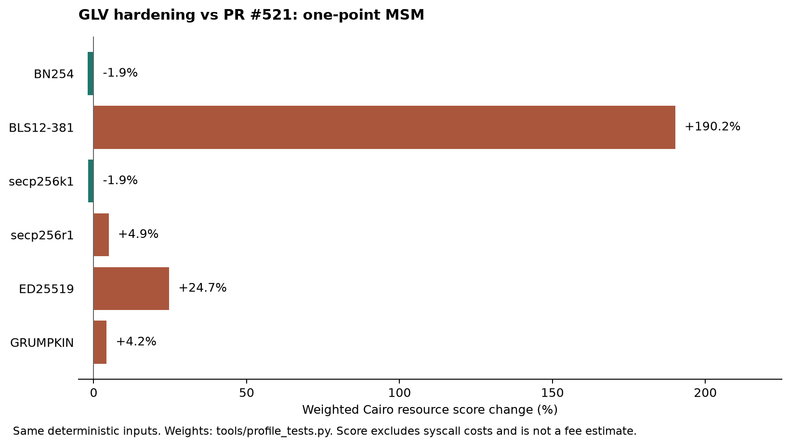

# GLV migration: security and performance impact

## Scope

The baseline is PR #521 at `a01fad00d0f77fe8e252ca8c2c64423e5efeb812`.
The upstream comparison uses gnark commits through October 7, 2026.
The [source comparison](gnark-glv-comparison.md) maps each applicable fix and optimization.

This migration reaches Python, Rust, WASM/TypeScript, Cairo circuits, generators, signatures, verifier calldata, and class-hash references.
It does not add unrelated G2 or fixed-base APIs.

## Security evidence

Four baseline tests return false or noncanonical results:

1. A zero GLV denominator admits `Q = [3]P` for scalar `2`.
2. A BLS12-381 denominator divisible by three admits a three-torsion offset in `Q`.
3. An even ED25519 denominator admits a two-torsion offset in `Q`.
4. The modular curve check accepts `Q.y + p` and returns this noncanonical coordinate.

The [baseline probes](../benchmarks/glv/baseline-probes.cairo) and [execution log](../benchmarks/glv/security-before.log) reproduce these results.
The [hardened regressions](../../src/src/tests/scalar_mul_soundness_tests.cairo) reject these cases.
The [regression log](../benchmarks/glv/security-after.log) records the new rejection and positive cases.

The new constraints require canonical coordinates, Boolean signs, complete coefficient consumption, and an invertible GLV denominator.
BLS12-381 binds the input and result to the subgroup through a 64-bit cofactor preimage check.
ED25519 checks the prime component and torsion component separately, so mixed-order arithmetic remains exact.

A constrained inversion failure selects complete arithmetic for exceptional point combinations.
Correct multiplication now works for small scalars and subgroup-order boundary scalars.
ED25519 also supports pure torsion and mixed-order points.

## Completeness evidence

A separate valid secp256r1 witness uses `s1 = 5`, `s2 = -10`, and scalar `2^-1 mod r`.
Its final bias correction is infinity, and the pre-fix affine correction rejects it.
The [pre-fix log](../benchmarks/glv/completeness-before.log) records this completeness failure, not acceptance of a false multiplication.
The final guard verifies the full relation with complete arithmetic when the corrected table point is infinity.
Positive [regressions](../../src/src/tests/scalar_mul_soundness_tests.cairo) cover secp256r1, ED25519, and GRUMPKIN.
A negative regression rejects an incorrect result.

## Cairo resources

All measurements use Scarb/Cairo 2.21.0 and Starknet Foundry 0.64.1 on macOS arm64.
They use identical deterministic inputs before and after the migration.
The dataset contains 117 paired cases across MSM, ECDSA, Schnorr, EdDSA, drand, and five proof verifiers.

The weighted resource score uses the existing weights in `tools/profile_tests.py`.
It excludes syscall costs and is not a transaction-fee estimate.
The [raw dataset](../benchmarks/glv/cairo-paired.json) includes steps, memory holes, builtins, and approximate runner gas.

### One-point MSM



| Curve | Cairo steps: before → after | Weighted score: before → after | Score change |
|---|---:|---:|---:|
| BN254 | 8,984 → 9,589 | 2,065,978 → 2,026,672 | -1.9% |
| BLS12-381 | 8,997 → 31,967 | 2,072,674 → 6,014,226 | +190.2% |
| secp256k1 | 9,278 → 9,901 | 2,111,354 → 2,071,570 | -1.9% |
| secp256r1 | 7,026 → 7,994 | 2,223,216 → 2,332,674 | +4.9% |
| ED25519 | 6,865 → 10,430 | 2,193,698 → 2,735,206 | +24.7% |
| GRUMPKIN | 6,874 → 7,702 | 2,194,598 → 2,287,218 | +4.2% |

The combined changes reduce weighted resources on BN254 and secp256k1.
The shorter 65-bit loop contributes to this reduction.
New canonical, sign, and complete-arithmetic checks increase native Cairo steps.
BLS12-381 and ED25519 spend more resources to enforce the missing subgroup or torsion constraints.

### Proof verifiers

| Test | Cairo steps: before → after | Weighted score change |
|---|---:|---:|
| Groth16 BN254 | 233,180 → 234,268 | +0.04% |
| Groth16 BLS12-381 | 337,397 → 392,575 | +14.90% |
| Noir Ultra Keccak ZK Honk | 1,220,719 → 1,283,872 | +0.97% |
| RISC0 Groth16 | 274,221 → 273,560 | -0.67% |
| SP1 Groth16 | 257,965 → 258,859 | -0.31% |

`test_decrypt_at_round` remains at 289,977 steps and a weighted score of 89,953,552.
The raw dataset also records every measured EdDSA message size and signature curve.

## Host production and calldata

The benchmark measures complete, uncached one-point calldata production through the public Python and Rust APIs.
Each phase contains 1,200 timed calls on the same seeded full-width scalars and subgroup points.
Each input has one warmup and five timed calls.
The benchmark reports the median of per-input medians for wall time and process CPU time.

Both phases use CPython 3.14.7 and optimized Rust 1.97.0 builds.
Debug symbols avoid a local Xcode linker defect. They do not disable release optimization.

| Curve | Python CPU: before → after | Rust CPU: before → after |
|---|---:|---:|
| BN254 | 0.682 → 0.696 ms | 1.352 → 1.435 ms |
| BLS12-381 | 8.136 → 28.285 ms | 2.771 → 14.337 ms |
| secp256k1 | 0.721 → 0.711 ms | 1.164 → 1.169 ms |
| secp256r1 | 0.631 → 0.645 ms | 1.222 → 1.285 ms |
| ED25519 | 4.899 → 10.015 ms | 0.926 → 1.876 ms |
| GRUMPKIN | 0.584 → 0.604 ms | 1.204 → 1.261 ms |

Exact LLL on every input increased Rust secp256k1 CPU time by 32.05× in the first experiment.
The [initial comparison](../benchmarks/glv/hint-cpu-comparison-lll-only.json) records that result.
The final producer accepts an Eisenstein candidate only after the exact width, scalar relation, and denominator checks.
It uses the ported rank-four LLL algorithm for outliers.
The [final comparison](../benchmarks/glv/hint-cpu-comparison.json) records the resulting near-baseline BN254 and secp256k1 timings.

The final host run measures commit `c59517adbd68ef31e70878934597a2228ada9f1f`.
All four recorded producer source hashes and the native-extension binary hash match that measurement.
BLS12-381 CPU time rises by 3.48× in Python and 5.17× in Rust.
ED25519 CPU time rises by 2.04× in Python and 2.02× in Rust.

BLS12-381 hints grow from 12 to 28 felts. One-point full calldata grows from 25 to 41 felts.
ED25519 hints grow from 10 to 18 felts. One-point full calldata grows from 23 to 31 felts.
Other curves retain their hint sizes.

## Migration requirements

Use matching Cairo and calldata packages. Old BLS12-381 and ED25519 hints fail the new length checks.
BLS12-381 MSM inputs must belong to the prime-order subgroup. ED25519 retains full-curve support.
All MSM coordinates and scalars must use canonical encodings.
The earlier `_scalar_mul_fake_glv` export is private. Public MSM functions include the required cofactor checks.

Generated verifiers refer to the new UniversalECIP class hash.
The RISC0 sample, mutator-set verifier, and drand decrypt caller also contain updated dependency hashes.
These source changes do not declare classes on a public network.
Declare the matching dependency classes before deployment. Existing release class hashes remain historical records.

## Validation

The final local Cairo run passes all 190 library tests, including 43 security and completeness regressions.
All five generated proof verifiers and both mutator-set tests pass.
Python passes 793 tests with five skips. Rust passes 62 tests and one doctest.
WASM passes five tests. npm passes eight suites with 50 tests.
All four Node and browser integration examples pass with unchanged snapshots.

The maximum-log-N bytecode contains 68,466 entries against the 81,290-entry limit.
Regeneration preserves all 50 tracked generated files.
The [WASM rebuild record](../benchmarks/glv/wasm-idempotence.json) confirms byte-identical generated files and package output.

The [draft PR](https://github.com/keep-starknet-strange/garaga/pull/523) contains the current GitHub CI results.
No public-network deployments or package releases are part of this migration.

## Reproduction

The Cairo dataset records its measurement commands, toolchain versions, and resources.
The host datasets also record source hashes and Python-extension binary hashes.
The [host benchmark](../benchmarks/glv/benchmark_hint_cpu.py) accepts an output path through `--output`.

```bash
PYTHONPATH="$PWD/hydra:$PWD" uv run --python venv/bin/python --no-project python \
  docs/benchmarks/glv/benchmark_hint_cpu.py --output /tmp/hint-cpu.json
snforge test -p garaga --include-ignored --detailed-resources \
  --tracked-resource cairo-steps --color never
```

Run the same commands in a clean PR #521 worktree for the baseline.
Copy the host benchmark into that worktree before the baseline run.
For baseline security probes, copy `baseline-probes.cairo` into the baseline's test directory.
Register that module under `#[cfg(test)]` in `src/src/lib.cairo`.
Run `snforge test -p garaga test_baseline_ --detailed-resources --tracked-resource cairo-steps`.
